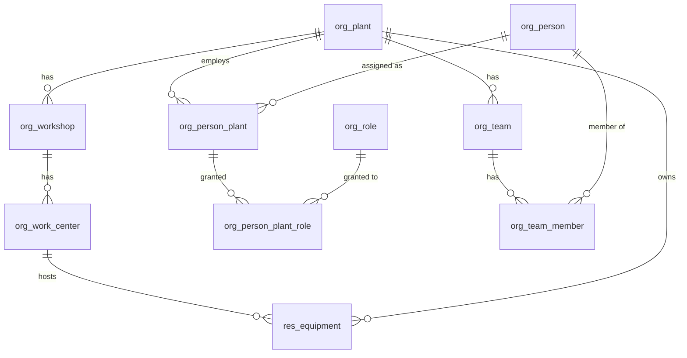
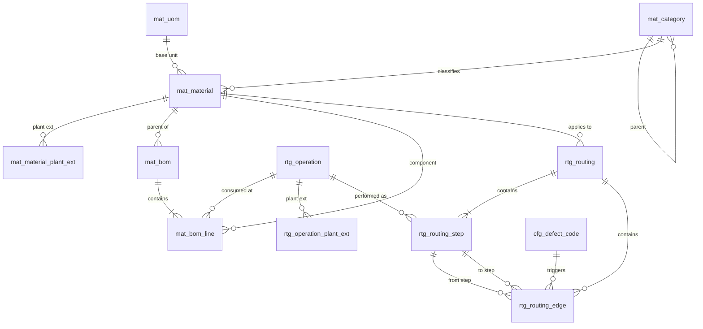
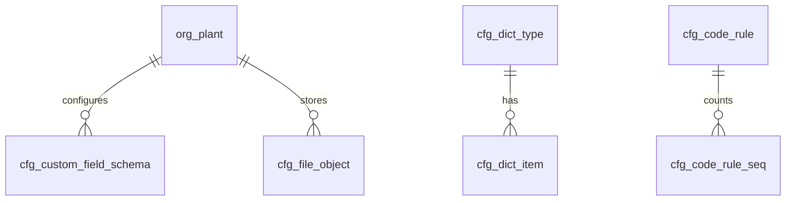
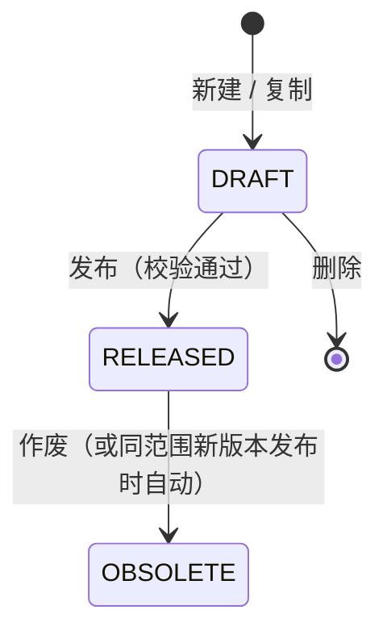

# V1 数据模型：主数据

状态：草案，待评审。DDL 见 [`sql/V2__master_data.sql`](sql/V2__master_data.sql)（目标 PostgreSQL 17；已在 PGlite（PG 18 内核）上接在 V1 之后整份执行通过，并冒烟了发布唯一与编码取号）。约定与【假设】编号见 [总览](v1-master-data-overview.md)。

共 29 张表：`org_` 9、`mat_` 6、`rtg_` 5、`res_` 1、`cfg_` 8。

## 公共列

下表各实体只列业务列。凡标「根」的表另有：

| 列 | 类型 | 说明 |
| --- | --- | --- |
| `id` | `uuid` PK | 默认 `gen_random_uuid()` |
| `lock_version` | `integer` 非空，默认 0 | 乐观锁（`@Version`） |
| `deleted` | `boolean` 非空，默认 false | 逻辑删除（`@TableLogic`）。扩展表与子表没有此列 |
| `created_at` / `updated_at` | `timestamptz` 非空 | 审计 |
| `created_by` / `updated_by` | `uuid` 可空 | 审计；auth 落地前为空，不建外键 |

唯一约束都是部分索引 `WHERE NOT deleted`。

范围列：

- 厂自有表：`plant_id uuid NOT NULL → org_plant`。
- 共享型表：`plant_id uuid NULL → org_plant`，空 = 共享，非空 = 该厂私有，创建后不可改。
- 扩展表：`plant_id NOT NULL`，`(主表 id, plant_id)` 唯一。

## ER

## org

### `org_plant` 工厂（全局，根）

| 列 | 类型 | 约束 / 说明 |
| --- | --- | --- |
| `code` | `varchar(32)` | 唯一 |
| `name` | `varchar(128)` | 非空 |
| `timezone` | `varchar(64)` | 默认 `Asia/Shanghai` |
| `enabled` | `boolean` | 默认 true |
| `remark` | `varchar(500)` | |

### `org_workshop` 车间（厂自有，根，`entity_type = workshop`）

`plant_id`、`code varchar(32)`（厂内唯一）、`name`、`enabled`、`remark`、`ext_values jsonb`。

### `org_work_center` 工作中心（厂自有，根，`entity_type = work_center`）

`plant_id`、`workshop_id → org_workshop`（非空，同厂）、`code`（厂内唯一）、`name`、`work_center_type`（字典 `work_center_type`）、`enabled`、`remark`、`ext_values`。

### `org_person` 人员（全局，根）

`code varchar(32)` 工号（全局唯一）、`name`、`mobile`、`email`、`enabled`、`remark`。不含登录信息（账号在 `auth`，见 A15）。

### `org_person_plant` 工厂任职（人员的厂扩展，`entity_type = person`）

| 列 | 类型 | 约束 / 说明 |
| --- | --- | --- |
| `person_id` | `uuid` → `org_person` | `(person_id, plant_id)` 唯一 |
| `plant_id` | `uuid` → `org_plant` | 非空 |
| `workshop_id` | `uuid` → `org_workshop` | 可空，同厂 |
| `job_title` | `varchar(64)` | |
| `active` | `boolean` | 无效任职不能登录该厂 |
| `ext_values` | `jsonb` | 该厂人员自定义字段 |

有 `lock_version` 与审计列，无 `deleted`。

### `org_role` 角色（全局，根）

`code`（唯一）、`name`、`remark`。种子：`VIEWER`、`EDITOR`、`ADMIN`。

### `org_person_plant_role` 角色授予（子表）

PK `(person_plant_id, role_id)`，随任职级联删除。

### `org_team` 班组（厂自有，根）

`plant_id`、`workshop_id`（可空）、`code`（厂内唯一）、`name`、`leader_person_id → org_person`、`enabled`、`remark`。

### `org_team_member` 班组成员（子表）

PK `(team_id, person_id)`。成员与负责人须在该厂有有效任职（应用校验）。

## material

### `mat_category` 物料分类（全局，根，树）

`parent_id`（自引用，可空）、`code`（唯一）、`name`、`sort_no`、`enabled`。不得成环（应用校验）。

### `mat_uom` 计量单位（全局，根）

`code varchar(16)`（唯一）、`name`、`decimals smallint` 0–6、`enabled`。V1 无换算（A10）。

### `mat_material` 物料（共享型，根，`entity_type = material`）

| 列 | 类型 | 约束 / 说明 |
| --- | --- | --- |
| `plant_id` | `uuid` | 空 = 共享 |
| `code` | `varchar(64)` | 全局唯一；为空提交时按编码规则生成 |
| `name` | `varchar(200)` | 非空 |
| `spec` | `varchar(500)` | 规格型号 |
| `material_type` | `varchar(32)` | 非空，字典 `material_type` |
| `category_id` | `uuid` → `mat_category` | |
| `uom_id` | `uuid` → `mat_uom` | 非空，主单位 |
| `drawing_no` | `varchar(64)` | 图号 |
| `status` | `varchar(16)` | `DRAFT` / `RELEASED` / `OBSOLETE` |
| `released_at` / `released_by` | | 发布时写 |
| `remark` | `varchar(500)` | |

### `mat_material_plant_ext` 物料厂扩展

`material_id`、`plant_id`（唯一对）、`enabled`（本厂是否启用，默认 true）、`ext_values`；有 `lock_version` 与审计列。行不存在等于「启用、无扩展值」，首次写扩展值时创建。物料作废后扩展值仍可读，不可写。

### `mat_bom` BOM 版本（共享型，根）

| 列 | 类型 | 约束 / 说明 |
| --- | --- | --- |
| `material_id` | `uuid` → `mat_material` | 父件 |
| `plant_id` | `uuid` | 空 = 共享版本；非空 = 该厂专用版本（A8） |
| `version_no` | `varchar(16)` | `(material_id, plant_id, version_no)` 唯一（`NULLS NOT DISTINCT`） |
| `base_qty` | `numeric(18,6)` | 基数，> 0，默认 1 |
| `status` | `varchar(16)` | 同物料 |
| `released_at` / `released_by` / `remark` | | |

部分唯一索引 `uk_mat_bom_released`：同父件同范围至多一个 `RELEASED`。

### `mat_bom_line` BOM 行（子表）

`bom_id`（级联删）、`line_no`（BOM 内唯一）、`component_material_id`、`qty numeric(18,6) > 0`、`uom_id`、`scrap_rate numeric(7,4)` ∈ [0,1)、`operation_id → rtg_operation`（消耗工序，可空）、`remark`。

发布校验（应用层）：父件为 `RELEASED`；组件非 `OBSOLETE`；组件 ≠ 父件；按各组件当前发布 BOM 展开不成环；范围遵守跨厂规则。

## routing

### `rtg_operation` 工序（共享型，根，`entity_type = operation`）

`plant_id`、`code`（全局唯一）、`name`、`operation_type`（字典）、`std_time_sec numeric(12,2)`、`enabled`、`remark`。工序没有版本状态，用 `enabled`。

### `rtg_operation_plant_ext` 工序厂扩展

`operation_id`、`plant_id`（唯一对）、`enabled`、`default_work_center_id → org_work_center`（同厂）、`std_time_sec`（空 = 不覆盖共享值）、`ext_values`。

### `rtg_routing` 工艺路线版本（共享型，根）

| 列 | 类型 | 约束 / 说明 |
| --- | --- | --- |
| `plant_id` | `uuid` | 空 = 共享；非空 = 厂专用。同一 `code` 的各版本范围相同 |
| `code` | `varchar(64)` | `(code, version_no)` 唯一 |
| `version_no` | `varchar(16)` | |
| `name` | `varchar(200)` | |
| `material_id` | `uuid` → `mat_material` | 适用产品，可空 = 通用 |
| `status` 等 | | 同 BOM；`uk_rtg_routing_released`：同编码至多一个 `RELEASED` |

### `rtg_routing_step` 工序节点（子表）

`routing_id`（级联删）、`step_no int > 0`（路线内唯一，建议 10、20、30）、`operation_id`、`work_center_id`（仅厂专用路线可填，A9）、`is_rework`（返工专用节点，不在主路线上）、`std_time_sec`、`remark`。

### `rtg_routing_edge` 返工边（子表）

| 列 | 说明 |
| --- | --- |
| `from_step_id` / `to_step_id` | 同一路线的节点，不相等 |
| `edge_type` | `REWORK`：主路线节点 → 返工节点，或 → 前序主路线节点；`RETURN`：返工节点 → 主路线节点 |
| `defect_code_id` | 触发不良，可空 |

主路线 = `is_rework = false` 的节点按 `step_no` 升序，不用边表达。发布校验：至少一个主路线节点；每个返工节点至少一条入边（`REWORK`）和一条出边（`RETURN`）；`REWORK` 回到主路线时只能指向 `step_no` 不大于起点的节点；工序未停用；范围遵守跨厂规则。

## resource

### `res_equipment` 设备（厂自有，根，`entity_type = equipment`）

`plant_id`、`work_center_id`（可空，同厂）、`code varchar(64)`（厂内唯一）、`name`、`equipment_type`（字典）、`model`、`manufacturer`、`serial_no`、`commissioned_on date`、`status`（`IN_SERVICE` / `IDLE` / `MAINTENANCE` / `SCRAPPED`，台账状态，不是实时状态）、`remark`、`ext_values`。

## config

### `cfg_custom_field_schema` 自定义字段配置

| 列 | 类型 | 约束 / 说明 |
| --- | --- | --- |
| `plant_id` | `uuid` 非空 | `(plant_id, entity_type)` 唯一 |
| `entity_type` | `varchar(32)` | `material` / `operation` / `person` / `workshop` / `work_center` / `equipment`（A6） |
| `schema` | `jsonb` | 形状即 [架构备忘](architecture.md)「动态表单」的配置：`{ schemaVersion, fields: [...] }`。原样保存，不写组件名 |

有 `lock_version` 与审计列。未配置时读接口返回 `{ "schemaVersion": 1, "fields": [] }`。

保存配置时的校验（应用层）：

- `type` ∈ 八种闭合类型；`key` 匹配 `^[a-z][a-z0-9_]{0,39}$` 且配置内唯一；`title` 1–64 字符。
- `enum` / `multi_enum` 的 `options` 1–200 项，`value` 唯一、≤ 64 字符；其他类型不得有 `options`。
- `validation` 只认架构备忘列出的约束词，且与 `type` 匹配；`pattern` ≤ 200 字符且 RE2J 可编译（A17）。
- 每厂每实体 ≤ 50 个字段（A19）。
- Schema **写路径严格白名单**（A20）：根仅 `schemaVersion`/`fields`；field 仅 `key`/`type`/`title`/`required`/`options`/`validation`/`layout`；任何未知键或 `widget`/`x-*` → 422 `SCHEMA_UNKNOWN_KEY`。不原样保留未知键。
- `fields.length` ≤ 50，否则 422 `SCHEMA_TOO_MANY_FIELDS`（A19）。
- `boolean` + `required`：值可为 `false`；缺 key / null 才算未填（A21）。
- 与已存配置比对：已有 `key` 的 `type` 不可改；`key` 不能改名（改名 = 删旧加新）。

### 扩展值 `ext_values`

存在扩展记录上（共享型的 `*_plant_ext`、任职行、厂自有表本行），JSON 对象，键为字段 `key`，值形状按架构备忘「值的形状」。

| 规则 | 约定（A19） |
| --- | --- |
| 未知 `key` | 写入时请求里出现配置外的键 → 422 `EXT_UNKNOWN_KEY`，不静默忽略 |
| `boolean` 必填 | key 必须出现；`false` 合法；`null`/缺省非法（A21） |
| 读 | 只返回当前配置里有的键；配置外的已存值（字段被删）保留在库里，不返回 |
| 写 | 以配置字段为准整体替换：配置内的键取请求值，请求未给 = 清空；配置外的已存键原样保留 |
| 校验 | 每次写入按当前配置校验全部字段：必填、类型、`options`、`validation`；`image` / `file` 校验文件存在且对当前厂可见 |
| 配置变更 | 不迁移、不批量重校已存值。删字段：值保留、不显示；重新加回同 `key` 同 `type` 时恢复显示。删选项 / 收紧校验 / 新增必填：旧值照常显示，该记录下次保存时必须改成合法值 |
| 大小 | 单条 `ext_values` 序列化 ≤ 64 KB；`string` 值 ≤ 2000 字符 |
| 查询 | V1 不支持按扩展值过滤与排序；需要时加 GIN 索引 |

### `cfg_dict_type` / `cfg_dict_item` 数据字典

类型（全局，根）：`code`（唯一）、`name`、`system`（系统字典不可删，可增项）、`remark`。种子：`material_type`、`work_center_type`、`operation_type`、`equipment_type`、`defect_category`、`reason_type`。

项（共享型，根）：`dict_type_id`、`plant_id`（空 = 共享项，非空 = 厂追加项）、`value`（字典内唯一，创建后不可改）、`label`、`sort_no`、`enabled`。被引用的项只能停用。

字典给内置列用（如 `material_type`）。自定义字段的选项写在字段自己的 `options` 里，不引用字典【假设】。

### `cfg_defect_code` 不良代码 / `cfg_reason_code` 原因代码（共享型，根）

不良：`code`（唯一）、`name`、`defect_category`（字典）、`severity`（`CRITICAL` / `MAJOR` / `MINOR`）、`enabled`、`remark`。

原因：`code`（唯一）、`name`、`reason_type`（字典：报废 / 返工 / 停机…，非空）、`enabled`、`remark`。

### `cfg_code_rule` / `cfg_code_rule_seq` 编码规则

规则（共享型）：`entity_type`（可编码的实体）、`plant_id`、`prefix`、`date_pattern`（`NONE` / `yyyy` / `yyyyMM` / `yyyyMMdd`）、`separator`、`seq_length` 1–12、`reset_cycle`（`NEVER` / `YEAR` / `MONTH` / `DAY`）、`enabled`。`(entity_type, plant_id)` 唯一（`NULLS NOT DISTINCT`）。

生成：`prefix + sep + 日期段 + sep + 左补零流水`，空段与其分隔符省略。例：`MAT-20261106-0001`、`EQ-0001`。

- 取规则：当前厂规则优先，其次共享规则；都没有则编码必填。
- 共享型实体（如共享物料）只用共享规则。
- 计数：`cfg_code_rule_seq` 主键 `(rule_id, period_key)`，`INSERT … ON CONFLICT DO UPDATE SET current_value = current_value + 1 RETURNING`，与业务写入同事务；回滚会留空号，可接受。
- 生成的编码若已被手工占用，继续取下一个，最多重试 10 次。
- 手工填写编码始终允许；规则只在编码为空时生效。

### `cfg_file_object` 文件元数据

`plant_id`（空 = 共享数据的文件）、`object_key`（唯一，服务端生成）、`file_name`、`content_type`（按魔数判定）、`size_bytes`、`created_at` / `created_by`。上传规则见总览「安全」。

## 版本状态

适用 `mat_material`、`mat_bom`、`rtg_routing`：

| 状态 | 主表与子表 | 厂扩展值 | 可被新引用 |
| --- | --- | --- | --- |
| `DRAFT` | 可改、可删 | 可改 | 物料草稿可作 BOM 组件草稿；发布时再校验 |
| `RELEASED` | 只读 | 可改 | 是 |
| `OBSOLETE` | 只读 | 只读 | 否（已有引用保留） |

取用某厂当前 BOM / 路线：先找该厂专用的 `RELEASED`，没有再找共享的 `RELEASED`（A8）。
